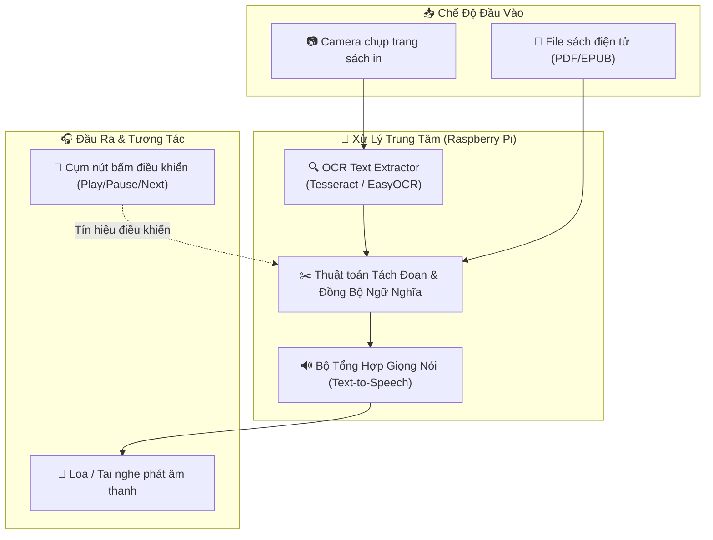

<div align="center">

# 📖 SMART BOOK READER FOR THE BLIND 📖
### 👁️ AI-Powered Optical Character Recognition & Text-to-Speech Assistive System
*Hệ Thống Đọc Sách Thông Minh Cho Người Khiếm Thị Ứng Dụng Raspberry Pi, OCR & Chuyển Đổi Giọng Nói*

[](https://python.org)
[](https://www.raspberrypi.com/)
[](https://github.com/tesseract-ocr/tesseract)
[](https://pypi.org/project/pyttsx3/)

---

</div>

> [!IMPORTANT]
> **Smart Book Reader for the Blind** là thiết bị trợ năng độc lập giúp người khiếm thị tiếp cận tri thức từ sách in truyền thống hoặc sách điện tử (PDF). Hệ thống chụp ảnh trang sách, nhận dạng ký tự quang học (OCR) và phát âm nội dung qua loa bằng giọng đọc tiếng Việt tự nhiên.

---

## 📑 Mục Lục (Table of Contents)
- [✨ Tính Năng Nổi Bật](#-tính-năng-nổi-bật)
- [🏗️ Kiến Trúc Hệ Thống](#️-kiến-trúc-hệ-thống)
- [📂 Cấu Trúc Dự Án](#-cấu-trúc-dự-án)
- [⚙️ Công Nghệ Sử Dụng](#️-công-nghệ-sử-dụng)
- [🚀 Hướng Dẫn Cài Đặt & Vận Hành](#-hướng-dẫn-cài-đặt--vận-hành)
- [🔮 Lộ Trình Phát Triển (Roadmap)](#-lộ-trình-phát-triển-roadmap)
- [📜 Giấy Phép (License)](#-giấy-phép-license)

---

## ✨ Tính Năng Nổi Bật

| Biểu Tượng | Tính Năng | Mô Tả Chi Tiết |
| :---: | :--- | :--- |
| 📸 | **Chụp Ảnh & Nhận Dạng OCR Trang Sách** | Tích hợp camera chụp trang sách, tự động xoay và trích xuất văn bản từ hình ảnh. |
| 📑 | **Hỗ Trợ Đọc File Sách Điện Tử (PDF)** | Tách đoạn thông minh, đồng bộ vị trí đọc và chuyển tiếp trang mượt mà. |
| 🔊 | **Phát Âm Thanh Giọng Nói Tiếng Việt** | Sử dụng công nghệ tổng hợp giọng nói Text-to-Speech (TTS) đọc mạch lạc theo từng câu. |
| 🎛️ | **Tương Tác Phím Bấm Vật Lý Đơn Giản** | Thiết kế nút bấm lớn (Play/Pause, Đọc lại, Chuyển trang) giúp người khiếm thị dễ dàng thao tác bằng xúc giác. |
| ☁️ | **Đồng Bộ Thư Viện Sách Máy Chủ** | Kết nối máy chủ đám mây để tải thêm các đầu sách mới về thiết bị nhúng. |

---

## 🏗️ Kiến Trúc Hệ Thống



---

## 📂 Cấu Trúc Dự Án

```bash
blind-people/
├── 📄 index.py            # Điểm bắt đầu điều phối luồng đọc sách trên Raspberry Pi
├── 📄 requirements.txt    # Danh mục thư viện Python phụ thuộc
├── 📂 src/                # Các module xử lý logic lõi:
│   ├── 📄 camera.py       # Quản lý module camera và chiếu sáng
│   ├── 📄 ocr.py          # Xử lý ảnh và trích xuất ký tự
│   ├── 📄 pdf_parser.py   # Tách đoạn và phân tích cấu trúc file PDF
│   └── 📄 tts_engine.py   # Quản lý giọng đọc và hàng đợi âm thanh
├── 📂 test/               # Kịch bản kiểm thử đọc âm thanh và kiểm thử phím bấm
└── 📄 README.md           # Tài liệu hướng dẫn dự án
```

---

## ⚙️ Công Nghệ Sử Dụng

- **Hardware Platform**: Raspberry Pi 3/4, Camera Module, USB Speaker, Push Buttons
- **OCR Engine**: Tesseract OCR, OpenCV (tiền xử lý ảnh làm phẳng trang)
- **Audio & TTS**: Python `pyttsx3`, `gTTS`, `pygame` / `pyaudio`

---

## 🚀 Hướng Dẫn Cài Đặt & Vận Hành

```bash
# 1. Clone repository trên Raspberry Pi
git clone https://github.com/baolam/blind-people.git
cd blind-people

# 2. Cài đặt các gói phần mềm hệ thống
sudo apt-get update
sudo apt-get install tesseract-ocr tesseract-ocr-vie espeak

# 3. Cài đặt thư viện Python
pip install -r requirements.txt

# 4. Khởi chạy hệ thống đọc sách
python index.py
```

---

## 🔮 Lộ Trình Phát Triển (Roadmap)

- [ ] 🤖 **LLM Smart Summarizer**: Tích hợp AI tóm tắt nội dung chương sách theo yêu cầu của người nghe.
- [ ] 🗣️ **Voice Navigation**: Hỗ trợ điều khiển chuyển sách hoàn toàn bằng khẩu lệnh.

---

<div align="center">

## 📜 Giấy Phép (License)

Dự án được phân phối dưới giấy phép **MIT License**.

---
**Made with ❤️ by [Bảo Lâm](https://github.com/baolam)**

</div>
